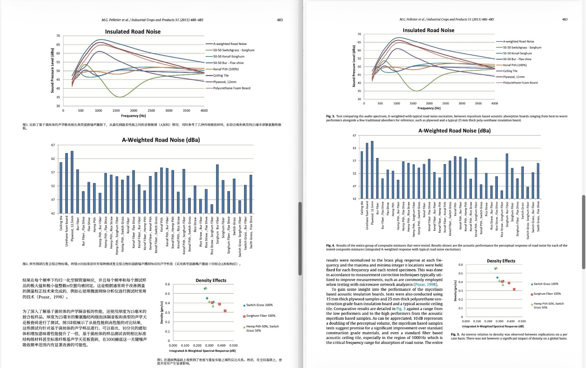

# TransOra

**On-device AI translation for macOS. Every request is handled on your Mac — your text never leaves it.**

[简体中文](README.md) · **English**

---

## What it is

A fully offline macOS translation tool: select text anywhere to translate it, or translate whole PDFs while keeping the original layout. It runs an 1.8B-parameter model on the GPU through Metal, needs no account and no network — it works in airplane mode.

- **14 common languages** in the UI (36 supported by the model), with automatic source-language detection and a target that is never the same as the source.
- **Selection translation**: select text in any app, a floating panel shows the translation with seven quick actions.
- **PDF**: text-only re-translation, or layout rebuild that writes the Chinese back into the original page.
- **Local only**: history, glossary and exports all live on this Mac.

## Why

There are plenty of translation apps. Almost all of them send your text somewhere. For contracts, medical records and unpublished drafts that is a non-starter. TransOra takes the opposite constraint as its design premise: **the text never leaves the machine**, therefore everything else follows — the model has to fit on the laptop, the inference has to be fast enough to feel instant, and the app must work with the network switched off.

## Core features

### Main window

Source and target language pickers with a one-click swap, streaming output, per-request seed so the same input reproduces, and a length setting (Short / Standard / Long / Longest) that trades latency for completeness.

### Select to translate

- Detects the selected text's language by writing system first (kana, hangul, han, thai, arabic, cyrillic), then falls back to the system language recogniser for Latin scripts — so selecting French no longer says "English → Chinese".
- The target language is configurable in Settings: **Automatic** (English → Chinese, Chinese → English) or pinned to a specific language.
- A non-activating panel appears next to the selection, with up to seven buttons: copy, save as TXT, save as DOCX, save to Notes, add to Reminders, speak, open in the main window. All of them can be toggled in Settings.
- Uses the Accessibility API first and falls back to a simulated ⌘C that never clears your clipboard.

### Long PDF translation

Extract text with PDFKit → chunk by page → translate serially → show live progress, cancellable at any time → export. Verified on a 310-page / 1.53M-character document (2787 chunks).

It can also rebuild the original layout: translations go back into their original columns while figures, formulas, captions, headers and page numbers stay untouched. When a translation does not fit it first tightens leading, then shrinks type, then widens the box, and only then moves the block to a footnote — never leaving overlapping text or blank pages.



*Same page: left is the Chinese rebuild (original columns and figure positions), right is the English source. Figures and captions are not translated.*

Scanned PDFs (image-only) are reported as unreadable — **no OCR**, because guessing is worse than saying no.

### History and glossary

Every translation (including selections) goes into a local SQLite database. Search, filter by language pair, export one or many entries as TXT / DOCX. The glossary pins terminology for the current language pair.

### Export

TXT and DOCX are **written in pure Swift** (DOCX is an OOXML ZIP generated in-process, CRC32 included) — no Office library, no Python.

### Menu bar

Closing the main window keeps the app alive in the menu bar, where selection translation can be toggled and the main window reopened.

## Under the hood

| Item | Detail |
| -- | -- |
| Model | `Hy-MT2-1.8B-1.25Bit.gguf`, 1.8B parameters, 1.25-bit quantised |
| Weight format | **Sherry STQ1_0, 1.3125 bpw**, resident in unified memory for GEMV — **not LUT4, not affine INT4** |
| File facts | GGUF v3 / 461,860,800 B / 354 tensors |
| Inference | Resident `MTLBuffer`, 225 GEMV per token, weights never expanded to fp16 |
| Language | Swift 6 + SwiftUI + AppKit, strict concurrency |
| Storage | SQLite (`libsqlite3`) |
| Dependencies | **Zero** — `otool -L` lists only system dylibs; no MLX, no metal-cpp, no SwiftPM packages |

**Why bpw matters**: at 1.3125 bits per weight the 1.8B model occupies 440 MB, small enough to stay resident on an 18 GB laptop instead of being reloaded for every request. That is what makes "double-click and translate in 0.8 s" possible.

## Quality and performance

| Metric | Result | Note |
| -- | -- | -- |
| BLEU | **23.19** | Against reference translations |
| chrF2 | **43.86** | Same |
| COMET | **0.7809** | `Unbabel/wmt22-comet-da`, real inference |
| Direction coverage | 36 × 35 = **1260 pairs** | 64 scored, 1196 smoke-tested |
| Degenerate pairs | 491 → **0** | No more "source == target" no-ops |
| Short sentence | **~0.8 s** | "Hello, nice to meet you." → 你好，很高兴见到你。 |
| Main-thread load | **10.3 ms** / token avg | Inference never blocks the UI |
| Unit tests | **497 / 497** | Zero compiler warnings |

## Install and requirements

| Item | Requirement |
| -- | -- |
| Chip | Apple Silicon (arm64). **Intel Macs are not supported** |
| OS | macOS 14.0 or later |
| Disk | ~470 MB |
| Network | **Not required**, not even on first launch |
| Account | Not required |

Open the DMG, drag **译澜 / TransOra** into Applications, then **right-click → Open** the first time (the build is ad-hoc signed, not notarised).

The release bundle embeds the model, so there is nothing to download afterwards. A 5 MB lightweight build is also produced; it asks for a model folder on first launch.

## Build from source

The repository contains source, fonts and golden data. **Model weights and evaluation assets are not included** — the weights carry their own licence and the COMET assets are ~5 GB.

| Item | Requirement |
| -- | -- |
| Toolchain | Xcode 26 / Swift 6.x, Swift Package Manager |
| OS | macOS 14.0+, Apple Silicon |
| Model | Optional. Tests that need it are skipped when absent |

```bash
git clone https://github.com/shijuncai/transora.git
cd transora
swift build --disable-sandbox     # SwiftPM must run with the sandbox disabled here
./Scripts/test.sh                 # 497 tests
./Scripts/check-localization.sh   # every UI string has an English translation
```

For real inference, put the quantised Hy-MT2-1.8B GGUF at
`Models/Hy-MT2-1.8B-1.25Bit-GGUF/Hy-MT2-1.8B-1.25Bit.gguf`,
or point **Settings → Choose model folder** at it. The weights follow the upstream licence and are not redistributed here.

```bash
./Scripts/make-app.sh            # dist/TransOra.app (HYMN_EMBED_MODEL=0 for a 5 MB build)
./Scripts/make-release.sh        # build → tests → icon → .app → smoke test → DMG
```

| Directory | Contents |
| -- | -- |
| `Sources/HymnCore` | Inference backend, tokenizer, selection pipeline, PDF layout rebuild |
| `Sources/HymnStore` | History and glossary (SQLite) |
| `Sources/HymnSTQ` | STQ1_0 weight unpacking and GEMV kernels |
| `Sources/HymnApp` | SwiftUI UI, menu bar, selection panel |
| `Sources/hymnctl` · `hymntest` | CLI and test suites |
| `Scripts` | Build, icon, font, release scripts |
| `Golden` | Golden tensors used by tests |

## Known limitations

These are today's real limits, not future promises:

- **Not notarised by Apple**: ad-hoc signature only; Gatekeeper blocks the first launch. Right-click → Open, or `xattr -dr com.apple.quarantine /Applications/TransOra.app`.
- **Apple Silicon only**; Intel Macs and macOS 13 or earlier cannot run it.
- **Selection translation needs Accessibility permission.** Without it the main window, PDF and history still work.
- **Permission may reset after a rebuild**: every ad-hoc re-sign changes the signature fingerprint. Keep one copy in `/Applications` and delete old entries in System Settings.
- **Reading selections in web/Electron apps**: Accessibility first, simulated copy second; if the target app does not respond, the panel stays closed rather than showing the wrong text.
- **PDF chunking loses cross-chunk context**: paragraph flow across a chunk boundary is weaker than translating the whole document at once, and hundreds of pages take hours.
- **No OCR**: scanned documents are reported, never guessed.
- **Memo import** lands in the "Imported" folder as plain text with the first translated line as title — that avoids the Automation permission, at the cost of formatting.
- **Reminders needs a one-time privacy grant.**
- **Latin-script languages cannot always be told apart** (Spanish vs Portuguese, for example); pick the language manually.
- **No Windows or Linux build.**

## Version

Current: **0.8.8 (build 28)**

Two hard constraints hold across every version: **describe the format honestly** (no calling STQ1_0 "LUT4") and **keep inference fully local** (no silent fallback to cloud or Python).

---

## Licence

Code is released under **MIT** — see [LICENSE](LICENSE). The bundled Chinese font is an instance of Source Han Serif and follows the SIL Open Font License 1.1 (see `Resources/Fonts/OFL.txt`); model weights follow the upstream publisher's terms and are not part of this repository. Details in [THIRD-PARTY-NOTICES.md](THIRD-PARTY-NOTICES.md).
